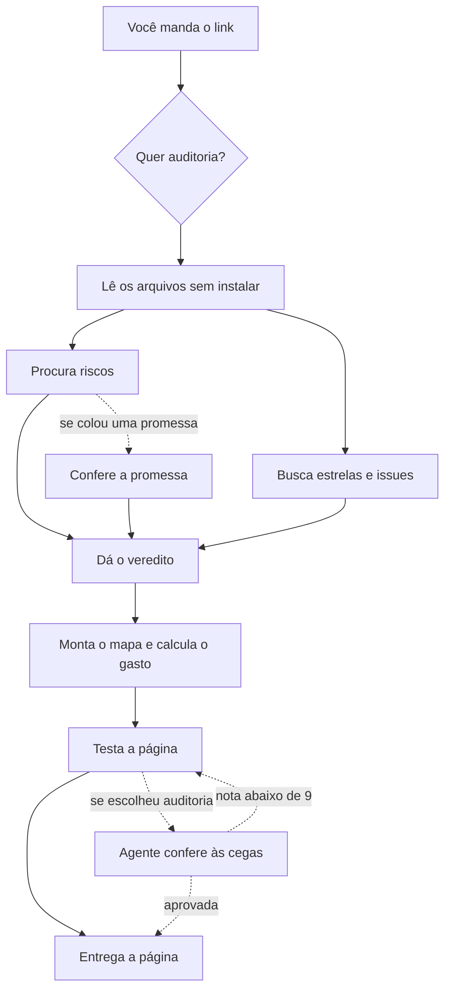

# Antes de baixar

Uma skill para agentes de IA que analisa outra skill do GitHub **antes** de você instalar.

Você manda o link. Ela lê os arquivos, sem instalar nem executar nada, e monta uma página com:

- veredito: instalar, instalar com ressalva ou não instalar, com o motivo;
- o que a skill faz na prática e para quem ela serve;
- o que ela roda, o que toca, o que envia para a internet e de que depende;
- estimativa de gasto para carregar;
- estrelas, atividade e as issues mais comentadas;
- um mapa interativo do processo.

Se você viu uma promessa sobre a skill, pode colar junto. A página responde se os arquivos confirmam, desmentem ou não permitem dizer.

Veja um exemplo em `exemplo/mapa-webapp-testing.html`.

## Como ela funciona



**[Abrir o mapa interativo](https://guiair21.github.io/antes-de-baixar/)**, com filtros e detalhes de cada etapa.

## Instalar

Copie esta pasta para `~/.claude/skills/antes-de-baixar`. Depois, abra uma sessão nova:

```
/antes-de-baixar https://github.com/dono/repositorio
```

Precisa de Python 3 e do GitHub CLI (`gh`) para os dados do repositório.

## Limites

- Ler o código reduz o risco, mas **não garante segurança**. O veredito é uma leitura, não uma certificação.
- O gasto na página é estimativa, com a premissa à vista. O limite em tokens dos planos não é público.
- A auditoria por um segundo agente é opcional e custa bem mais que a análise.

Antes de instalar esta skill, leia o `SKILL.md`. Ela roda um único script local, `scripts/custo.py`, que faz a conta do gasto e, só com o comando `calibrar`, grava em `scripts/planos.json`. A análise usa os seus comandos `gh`, com o seu login. Toda página gerada traz, no rodapé, o crédito do autor com link; ele sai se você pedir.

## Crédito

Skill criada por Guilherme Carlos da Silva. Testo inteligência artificial para produzir conteúdo e conto o que deu certo e o que não deu: [@euguicarlos](https://www.instagram.com/euguicarlos/).

Licença MIT.
